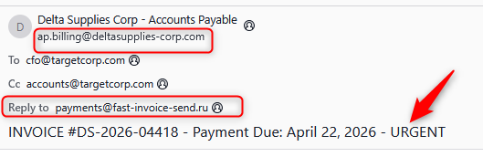
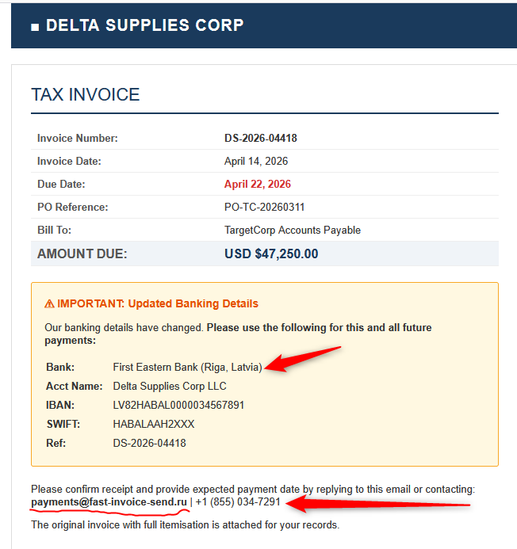
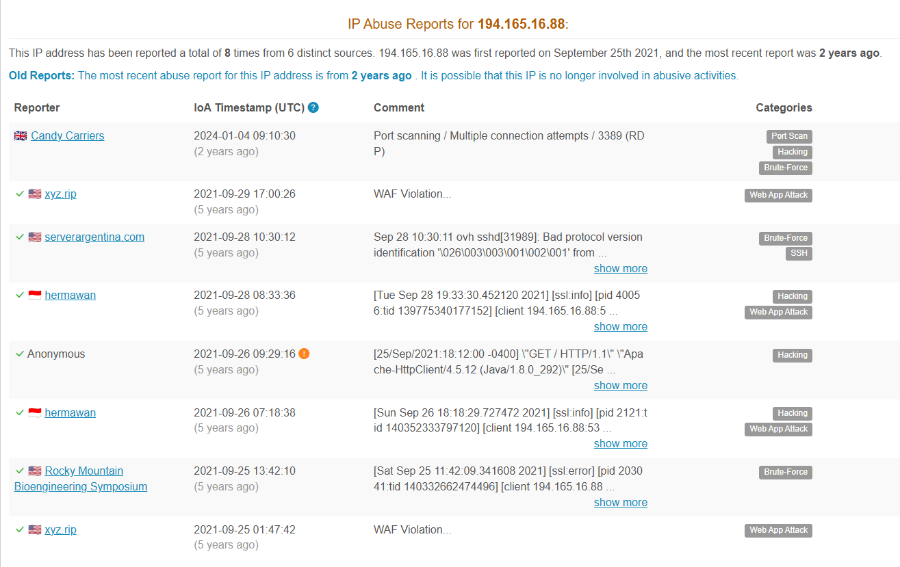

# Phishing Email Investigation Report — Delta Supplies Corp Invoice Fraud

## TargetCorp Threat Intelligence & Email Security Investigation

## 1. Executive Summary

This investigation examines a suspicious invoice-payment email impersonating Delta Supplies Corp. The message requests payment of **USD $47,250** for invoice `DS-2026-04418` and claims that the supplier's banking details have changed. It pressures the recipient to act before the stated payment deadline of April 22, 2026.

The investigation identified several indicators consistent with a potential **business email compromise (BEC) or invoice-payment phishing attempt**:

- A mismatch between the displayed sender and the Reply-To address.
- A payment-redirection request involving new banking details.
- A non-matching sender domain and email infrastructure associated with `fast-invoice-send.ru`.
- Failed SPF, DKIM, and DMARC checks in the analyzed message.
- Historical AbuseIPDB reports associated with two public IP addresses in the email headers.

The evidence supports treating the message as highly suspicious. However, the investigation does not independently establish who operated the infrastructure, whether the bank account belongs to a criminal, or whether a payment was made.

## 2. Investigation Objectives

- Examine the email's content, invoice details, and payment instructions.
- Identify inconsistencies in the sender and Reply-To information.
- Analyze the message headers and sending infrastructure.
- Review the public IP addresses using AbuseIPDB.
- Examine email authentication results using MXToolbox.
- Document indicators of compromise and recommend defensive actions.

## 3. Tools and Evidence Sources

- **Email sample and headers:** Message content, sender information, and routing details.
- **AbuseIPDB:** Public IP reputation and historical abuse reports.
- **MXToolbox:** SPF, DKIM, DMARC, and email-header analysis.
- **Manual analysis:** Social-engineering indicators, payment instructions, and domain inconsistencies.

## 4. Email Content Analysis

### 4.1 Email Summary

| Attribute | Observed details |
|---|---|
| Displayed sender | Delta Supplies Corp - Accounts Payable |
| Sender address | `ap.billing@deltasupplies-corp.com` |
| Recipient | `cfo@targetcorp.com` |
| CC | `accounts@targetcorp.com` |
| Subject | `INVOICE #DS-2026-04418 - Payment Due: April 22, 2026 - URGENT` |
| Invoice number | `DS-2026-04418` |
| Invoice date | April 14, 2026 |
| Stated payment deadline | April 22, 2026 |
| Amount requested | USD $47,250.00 |
| PO reference | `PO-TC-20260311` |

### Supporting Evidence: Email Sample

### 4.2 Urgency and Payment Redirection

The message announces updated banking details and instructs the recipient to use them for the current and future payments. The supplied details identify First Eastern Bank in Riga, Latvia, and include an account name, IBAN, SWIFT code, and invoice reference.

The email also asks the recipient to confirm receipt and provide an expected payment date by replying to the supplied address.

These are important warning signs because fraudulent invoice schemes often attempt to redirect legitimate business payments to accounts controlled by an unauthorized party.

The stated deadline and urgent subject line may encourage the recipient to act before independently verifying the change.

**Evidence:**

### 4.3 Sender and Reply-To Analysis

The message uses different domains for the displayed sender and the Reply-To address.

| Field | Observed value |
|---|---|
| From | `ap.billing@deltasupplies-corp.com` |
| Reply-To | `payments@fast-invoice-send.ru` |
| Return-Path | `billing@fast-invoice-send.ru` |
| X-Originating-IP | `194.165.16.101` |
| X-PHP-Originating-Script | `500:invoice_blast.php` |
| X-Mailer | Microsoft Outlook 16.0.14931.20132 |

The Reply-To and Return-Path use `fast-invoice-send.ru`, rather than the displayed sender's domain. This could redirect replies away from the apparent supplier and is a significant indicator requiring verification.

The originating script field references `invoice_blast.php`. This is contextual evidence about the message headers, not proof by itself that the message was malicious.

A sender-domain discrepancy can sometimes occur in legitimate email systems. In this case, however, it appears alongside the banking-change request and failed authentication checks, increasing concern.

**Evidence:**

## 5. Email Header and Authentication Analysis

### 5.1 Observed Message Route

The MXToolbox analysis shows the following routing information:

| Hop | Observed information |
|---|---|
| Initial hop | `10.0.0.14` |
| Next sending server | `mail.biz-invoice.ru` — `194.165.16.88` |
| Subsequent sending server | `smtp.fast-invoice-send.ru` — `194.165.16.101` |
| Receiving server | `mx.google.com` |

The private address `10.0.0.14` is not a publicly routable Internet address and should not be treated as a public attacker IP. The two public IP addresses are relevant to the observed message route, but their presence does not independently identify the person responsible.

### 5.2 Authentication Results

The analyzed headers report:

- **SPF: Fail** — the sending IP was not authorized by the evaluated SPF policy for `deltasupplies-corp.com`.
- **DKIM: Fail** — signature verification failed because the key did not match.
- **DMARC: Fail** — the message did not pass the evaluated DMARC checks.
- **Alignment concerns:** The evaluated sender and envelope-from domains did not align.

These failures undermine confidence that the message was properly authenticated as originating from the apparent sender. They can result from misconfiguration or message alteration as well as malicious activity, so they should be interpreted together with the other evidence.

**Evidence:**

### 5.3 MXToolbox Results

The MXToolbox analysis also reports that no DMARC record was found for the evaluated domain and identifies SPF, DKIM, and alignment failures.

The routing analysis identifies the two public IP addresses examined in the next section.

**Evidence:**

## 6. Threat Intelligence and IP Reputation

### 6.1 IP Address: `194.165.16.88`

AbuseIPDB returned the following information at the time of analysis:

| Attribute | Result |
|---|---|
| Abuse reports | 8 |
| Confidence of abuse | 0% |
| ISP | Flyservers S.A. |
| Usage type | Data Center/Web Hosting/Transit |
| ASN | AS48721 |
| Country | Lithuania |
| City | Vilnius |
| Most recent report | Approximately two years before the lookup |

The historical reports include port scanning, multiple connection attempts, web application activity, and other suspicious network behavior. However, AbuseIPDB displayed a **0% confidence score**, and the most recent report was old.

These findings provide historical context but do not establish that the address was malicious during this email's delivery or that it was operated by the sender of the message.

**Evidence:**

### 6.2 IP Address: `194.165.16.101`

AbuseIPDB returned the following information:

| Attribute | Result |
|---|---|
| Abuse reports | 42 |
| Confidence of abuse | 0% |
| ISP | Flyservers S.A. |
| Usage type | Data Center/Web Hosting/Transit |
| ASN | AS48721 |
| Country | Lithuania |
| City | Vilnius |
| Most recent report | Approximately three years before the lookup |

The historical reports include port scanning, multiple unauthorized connection attempts, and reported RDP login failures.

Although the report count is higher than for `194.165.16.88`, the displayed confidence score remains 0%, and the reports are historical. Report count alone is not proof of current malicious activity.

The IP address appears in the email's headers as the originating IP and in the evaluated SPF failure. This makes it relevant to the investigation, but it does not establish the identity of the operator or prove that the address was used exclusively for phishing.

**Evidence:**

## 7. Consolidated Indicators of Concern

| Indicator | Observation | Significance |
|---|---|---|
| Payment amount | USD $47,250 | High-value payment at risk |
| Banking instructions | Updated account details supplied by email | Potential payment-redirection attempt |
| Sender domain | `deltasupplies-corp.com` | Must be independently verified against the legitimate supplier |
| Reply-To domain | `fast-invoice-send.ru` | Differs from the displayed sender domain |
| Return-Path domain | `fast-invoice-send.ru` | Consistent with the alternate reply infrastructure |
| Public IP | `194.165.16.88` | Historical AbuseIPDB reports; 0% confidence |
| Public IP | `194.165.16.101` | Historical AbuseIPDB reports; 0% confidence |
| SPF | Fail | Sending IP not authorized by the evaluated policy |
| DKIM | Fail | Signature verification failed |
| DMARC | Fail | Authentication evaluation failed |
| Social engineering | Urgent payment subject and deadline | May pressure the recipient into acting without verification |

## 8. Key Findings

1. **Potential invoice-payment fraud:** The email requests a substantial payment and introduces changed banking details.
2. **Sender inconsistency:** The Reply-To and Return-Path use a different domain from the displayed sender.
3. **Authentication failures:** SPF, DKIM, and DMARC checks failed in the analyzed message.
4. **Relevant sending infrastructure:** Two public IP addresses appear in the headers and have historical AbuseIPDB records.
5. **Limited IP attribution:** Both IP addresses show a 0% AbuseIPDB confidence score in the supplied evidence. The historical reports do not prove current malicious activity or identify the sender.
6. **No confirmed financial loss:** The available evidence does not establish whether the recipient paid the invoice or whether any account was compromised.

## 9. Recommended Response and Defensive Actions

- Do not reply to the suspicious address or use the supplied banking details until independently verified.
- Contact the supplier using a previously verified telephone number or established contact channel.
- Compare the invoice number, purchase order, amount, and banking instructions with legitimate procurement records.
- If the payment was already made, contact the organization's finance team and financial institution immediately to report the suspected payment fraud.
- Preserve the original email, full headers, attachment, screenshots, and relevant message timestamps for investigation.
- Review mail gateway logs and other messages involving the observed sender, Reply-To domain, and sending infrastructure.
- Investigate whether similar payment-change requests were delivered to other employees.
- Review email authentication configuration and monitoring for the organization's legitimate domains.
- Follow the organization's incident-response and financial-fraud escalation procedures.

## 10. Conclusion

The Delta Supplies Corp message contains multiple indicators consistent with a possible business email compromise or invoice-payment phishing attempt. The high-value payment request, changed banking details, sender/Reply-To discrepancy, and failed email authentication checks make independent verification essential before any payment is authorized.

The AbuseIPDB findings provide historical context but are not conclusive evidence that either public IP address was malicious during this incident. Based on the available evidence, the email should be treated as **highly suspicious and escalated for verification**. No financial loss or successful compromise has been confirmed by this investigation.
